<div align="center">

<picture>
  <source media="(prefers-color-scheme: dark)" srcset="docs/images/icon-dark.png">
  
</picture>

# Inky

**A fast, open source launcher for macOS.**<br>
Press a hotkey anywhere, type, and act.

[Download](https://github.com/Hinkolas/inky/releases) ·
[Changelog](CHANGELOG.md) ·
[Security and privacy](SECURITY.md)

</div>

Launch apps, open links with arguments, search your clipboard history,
calculate and convert, ask for the time somewhere, look at a color, find
files and run system commands. Every command can have a hotkey of its own.
No accounts, no subscriptions, no telemetry.

> [!WARNING]
> Inky is at an early stage. Its behavior and the format of its data may still
> change between versions; back up the data you want to keep.

## Install

Download the disk image of the latest version from the
[releases page](https://github.com/Hinkolas/inky/releases), open it and drag
Inky to Applications. Every version is signed and notarized, and updates
itself.

Inky needs a Mac with Apple silicon and macOS 15 or later. The first launch
walks you through the hotkey, the features you want and the permissions they
need. The default hotkey is ⌥Space.

Updates come in two channels, chosen under Settings → General: **Stable** gets
releases, **Beta** also gets alpha, beta and release candidate versions. A
pre-release you downloaded starts on Beta.

## Features

- **Applications.** Fuzzy search over your apps, ranked by how often and how
  recently you pick them.
- **Quicklinks.** Named shortcuts to websites, folders and app links, with
  placeholders such as `{argument name="Query"}`, `{clipboard}` and
  `{selection}`. Arguments are typed right in the search bar.
- **Clipboard history.** Text, links, colors, images and files you copied,
  searchable and ready to paste again. Pin what you need often and give it a
  name.
- **Calculator.** `128 * 3 + 4`, `20% off 80`, units (`5 ft 10 in in cm`),
  currencies (`100 usd in eur`), number bases (`255 in hex`) and CSS units
  (`2rem in px`).
- **Time.** `time in tokyo`, `5pm london in berlin`, `monday in 3 weeks`,
  `days until 24 dec`.
- **Color.** Type `#ff6363` or `oklch(0.7 0.19 23)` to see a color and copy
  it written another way, from hex and HSL to a color in Swift.
- **Browser.** Type a web address, such as `amazon.com` or `localhost:3000`,
  and Return opens it in your browser.
- **Uninstall applications.** Remove an app together with what it left in your
  Library. You review every file, and everything goes to the Trash.
- **Commands and hotkeys.** Switch off what you never use, and give any
  command a hotkey: launch an app, lock the screen, open a folder.
- **Fallback commands.** Send a search on to a web search or another command
  when nothing was found.
- **Contacts.** People and companies from your contacts, by name, nickname,
  company or email address: open them in Contacts, write to them or call.
  Search Contacts lists them all, by type or by group, with the numbers and
  addresses of the selected one. Inky asks before it reads them, under
  Settings → Contacts.
- **File search.** Files and folders from the Spotlight index, below the
  other results. Search Files shows more of them on a screen of its own, with
  a preview and details, and what you opened lately while nothing is typed.
- **System commands.** Lock, sleep, restart, empty the Trash, toggle dark
  mode.
- **Nothing typed is lost.** Click elsewhere and the launcher opens again as
  you left it, for a minute unless you choose otherwise. ↑ in the empty search
  brings back what you searched for before, arguments included.

### Keys

| Key | Action |
| --- | --- |
| ↓ | With nothing typed: show suggestions |
| ↑ | With nothing typed: bring back earlier searches, then ↑ ↓ go through them |
| ↑ ↓ (or ⌃P ⌃N) | Move the selection |
| ↵ | Run the first action |
| ⌘↵ | Run the second action |
| ⌘K | Show all actions |
| ⇥ | Jump to a quicklink's arguments |
| ⌃⇧⌘D | Disable the selected command |
| ⎋ | Clear, go back, or close |
| ⌘, | Settings |

## Privacy

Inky goes online for three things, and each can be turned off in Settings:

- **Website icons:** it asks DuckDuckGo for the icon of each website in your
  quicklinks, sending only the domain name. Local addresses such as
  `localhost` are never sent.
- **Exchange rates:** it downloads the European Central Bank's reference
  rates, the same file for everyone, so nothing about what you convert is sent.
- **Updates:** once a day it reads the list of releases from
  `getinky.dev/appcast.xml`, and installs only updates signed with Inky's
  release key.

Everything else stays on your Mac: your quicklinks, settings, usage and the
searches Inky remembers as readable JSON in
`~/Library/Application Support/Inky/`, and the clipboard history in a database
only your account can read. How many searches are remembered, if any, is
chosen under Settings → General.

> [!IMPORTANT]
> The clipboard history leaves out what password managers mark as
> confidential. A password copied from anywhere else cannot be told apart, and
> is kept without encryption. Turn the clipboard history off in Settings if
> that does not suit you.

Your contacts are read only once you allowed it, and are held in memory while
Inky runs: nothing of them is written to disk.

To keep what other apps copy, Inky needs to be allowed under System Settings →
Privacy & Security → Paste from Other Apps. To paste for you it presses ⌘V,
which takes Accessibility access; without it, Inky copies and you paste.
See [SECURITY.md](SECURITY.md) for storage, permissions and reporting a
vulnerability.

## Roadmap

- **Lua extensions.** Write your own commands in Lua. Inky's own features are
  built on the same module contract that extensions will use, so the API is
  already proven by real features.
- **Encrypted passwords** in the clipboard history, when you choose to keep
  them.
- **Working days and holidays** in the calculator: `workdays in march`,
  `55h in workdays`.
- **Airports** in the time module: `time in JFK`.

## Build from source

Requires Xcode 26 or later.

```sh
make run     # build and launch
make test    # run the core tests
make release # optimized local build (ad-hoc signed, does not update itself)
make places  # rebuild the list of cities from GeoNames
```

Or open `Inky.xcodeproj` in Xcode and run the `Inky` scheme.

A Debug build is an app of its own, **Inky (Debug)**, with its own bundle
identifier (`io.github.hinkolas.inky.debug`), settings, permissions and data
folder (`~/Library/Application Support/Inky (Debug)`). It never touches the
data of an installed Inky, and both can run side by side with different
hotkeys.

<details>
<summary><strong>How it is organized</strong></summary>

```
Inky/        The app: hotkey, launcher panel, settings. AppKit and SwiftUI.
InkyCore/    Everything without UI: search, ranking, modules, quicklinks.
```

Every feature is a module (see `InkyCore/Sources/InkyCore/Search/Module.swift`).
The ones that come with Inky, such as the calculator and quicklinks, are system
modules; an extension is a module that does not come with Inky. A module hands
the engine results as plain data: a title, an icon description, actions. The
app renders them.

A command's screen is put together from a small set of parts in
`Inky/Commands/CommandKit.swift`: `CommandScreen` (the header pill a command
configures and the body card), `Sidebar` for narrowing down what is shown,
`SidePanel` for previews, details and actions, and the rows, form groups and
controls that go inside them. Extensions will describe the same parts as data.

Your data is in `~/Library/Application Support/Inky/`: `quicklinks.json`,
`usage.json`, `fallbacks.json`, `commands.json` and `history.json`, the
searches ↑ brings back. The clipboard history is
in `Clipboard/history.sqlite`, with the images as files next to it, searched
through an SQLite FTS5 trigram index. macOS does not say when something is
copied; Inky looks at the pasteboard's change count twice a second and reads
it only when that moved (`InkyCore/Sources/InkyCore/Clipboard/`).

The calculator and the time module share a lexer and the table of units
(`InkyCore/Sources/InkyCore/Calculator/`), each with a recursive descent parser
of its own on top.

</details>

<details>
<summary><strong>Development flags</strong></summary>

Debug builds accept launch arguments that put the app into a known state:

```sh
"build/Build/Products/Debug/Inky (Debug).app/Contents/MacOS/Inky (Debug)" \
  --pin --query "saf" --keys "cmd+k down"
```

`--show`, `--pin` (stay open without focus), `--quiet` (draw beneath the desktop,
take no focus and register no hotkey or menu bar icon, for automated captures),
`--key` (with `--quiet`: take the keyboard while still hidden, to check where
focus ends up, and drop what is typed meanwhile),
`--query <text>`, `--keys "<keys>"` (among them `run:<command id>`, which does
what the command's hotkey does, and with `--key` also `hotkey` and
`hotkey:<command id>`, which press a real one, and `probe`, which prints
whether a key press arrives at the launcher), `--key-delay <milliseconds>`
(between those keys), `--run <command id>` (open the launcher the way the
command's hotkey does), `--settings [pane]`, `--search <text>` (what
the settings' list of all commands is narrowed down to),
`--onboarding [hotkey|features|clipboard|online|ready]` (the welcome window,
at a step), `--quicklinks`, `--new-quicklink`, `--uninstall [application]`,
`--clipboard [filter]`, `--clipboard-samples` (fill an empty history with
made-up copies, with `--data` only), `--appearance light|dark`,
`--backdrop light|dark` (a stand-in wallpaper behind a quiet launcher, to see
the translucency), `--data <folder>` (keep quicklinks, usage and the clipboard
history there instead of in your own, with a pasteboard to itself and without
pressing keys in other apps, and uninstall only the applications in its
`Applications`, with what they left in its `Library`),
`--motion full|reduced|off`, `--slow <factor>` (stretch every animation, to
look at one frame by frame), and `--resume <seconds>` (for how long a launcher
that was put away, as `toggle` in `--keys` does, opens again as it was left).

</details>

## Contributing and license

Bug reports and focused improvements are welcome; see
[CONTRIBUTING.md](CONTRIBUTING.md). Report vulnerabilities privately as
described in [SECURITY.md](SECURITY.md).

Inky is available under the [MIT license](LICENSE). The cities the time module
knows are from [GeoNames](https://www.geonames.org), under
[CC BY 4.0](https://creativecommons.org/licenses/by/4.0/); see the
[third-party notices](THIRD_PARTY_NOTICES.md).
